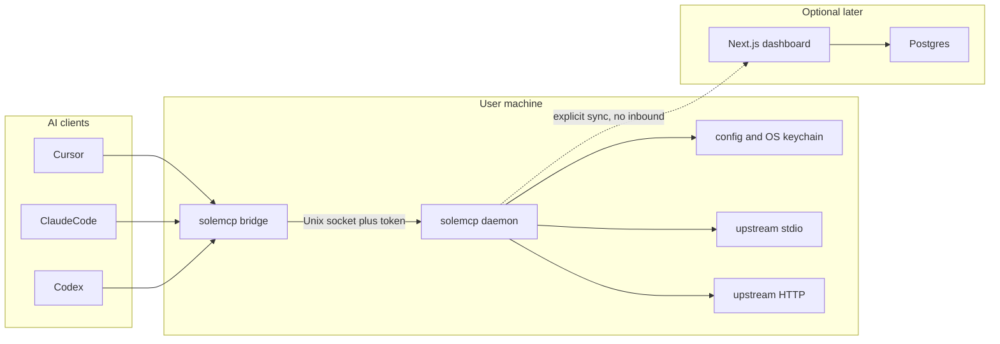
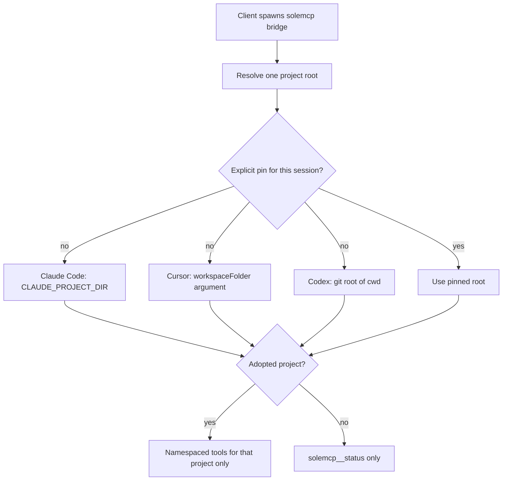

# SoleMCP

Implementation plan for a local-first, free, open-source MCP manager. This document is the spec. The first code milestone starts only after it exists, and that milestone is `packages/schema` and `packages/core`. No daemon and no client writes until the tests named in section 17 pass.

Working name: **SoleMCP**. CLI, repo folder, and config directory: `solemcp`. Public brand, GitHub org, npm org, and trademark clearance stay open until announcement.

## 1. Executive summary and competitive landscape

SoleMCP is the local control plane coding clients are missing. A developer installs one stdio entry, `solemcp bridge`, into Cursor, Claude Code, and Codex. A per-user daemon owns the upstream MCP servers. When a client starts a session, the bridge resolves that session's project and advertises only the tools that project is allowed to use. A folder that has not been adopted advertises one status tool and no upstreams.

That is the smallest design that stops the actual confusion: the same servers copied into three client configs, global entries leaking into every repo, and project files drifting apart. Rewriting those configs on every directory change recreates the sprawl. A loopback HTTP MCP listener, which is what MCPProxy uses (`127.0.0.1:8080`), puts the data plane on a TCP port this product leaves out. SoleMCP's data plane is a user-only Unix socket.

The tool list for a connection is fixed at session start. `notifications/tools/list_changed` is not a dependency. Claude Code refreshes on that notification. Cursor's support was reported unsupported by a June 2026 conformance check. Codex Desktop has an open report that it does not apply the notification. Policy edits apply on the next client reconnect, which is how these clients already spawn a server per workspace.

### Competitive landscape

Study competitors from public docs, READMEs, and licenses. Do not copy source, UI assets, or config formats. Do not decompile proprietary apps. Any unavoidable snippet stays license-compatible and attributed.

| Product | What it shows | What SoleMCP takes | What SoleMCP leaves |
| --- | --- | --- | --- |
| [Notion Custom Agents](https://www.notion.com/help/mcp-connections-for-custom-agents) | Business and Enterprise only. Admin-approved server URLs, per-connection tool toggles, read tools running automatically, write tools asking for confirmation, credentials bound to the person who authenticated that agent. Notion calls public MCP URLs from its cloud. As of 2026-10-12, [notion.com/releases](https://www.notion.com/releases) indexed 3.7 on 2026-09-15; no 3.8 release was found. | Admin URL approval, per-tool enablement, and write confirmation, all free and local. | Notion's cloud runtime. SoleMCP does not replace Notion Agent. Notion MCP can later be one upstream connector. |
| [MCPProxy](https://mcpproxy.app/) ([smart-mcp-proxy/mcpproxy-go](https://github.com/smart-mcp-proxy/mcpproxy-go), MIT) | Local Go binary, embedded web UI, optional macOS menu bar, stdio and HTTP upstreams, profiles, OS keyring, tool quarantine an LLM cannot lift, planned paid team tier at $799/month. Data plane on `127.0.0.1:8080`. Some docs still route clients through `mcp-remote`. | Human quarantine, profiles as the access boundary, keyring-backed secrets, import, a local activity view, and a later embedded management UI. | TCP MCP listener, paid tier, Docker requirement, BM25-only tool exposure. |
| [ravitemer/mcp-hub](https://github.com/ravitemer/mcp-hub) | One management API plus one MCP endpoint, namespaced tools, stdio and remote HTTP upstreams. Data plane `localhost:37373/mcp`. | Confirms the product shape: one client entry, namespaced tools. | MCP traffic on a TCP port. |
| [kilabyte/mcp-manager](https://github.com/kilabyte/mcp-manager) | macOS app that copies each server into every client config and injects secrets with `launchctl setenv`. | The per-client path table. | Writing every upstream into every client. Injecting secrets into the GUI launch environment. |
| [MikkoParkkola/mcp-gateway](https://github.com/MikkoParkkola/mcp-gateway) | Client scan, import preview, backup, rollback. | Import preview, backup, rollback. | Its fixed meta-tool surface is a later discovery mode, not the MVP. |
| [MCPJungle](https://github.com/mcpjungle/MCPJungle) | Tool groups decide which client sees which tools. | Project assignment is that idea, scoped to a repo instead of a shared cluster. | A shared cluster as the default install. |
| [daniel3303/McpManager](https://github.com/daniel3303/McpManager), [meta-mcp-manager](https://github.com/arthurkatcher/meta-mcp-manager) | Import existing JSON configs. Outbound OAuth tokens in a local vault. | Import. Local vault for tokens, post-MVP for upstream OAuth. | Inbound OAuth that publishes the gateway. |
| Docker MCP Gateway, IBM ContextForge, Obot | Isolation and registry ideas. | Ideas only, after the local product works. | Docker, Kubernetes, or a heavy service as the default install. |
| [onemcp.dev](https://onemcp.dev/), [onemcp.io](https://onemcp.io/), [DustinZhu/One-MCP](https://github.com/dustinzhu/one-mcp), [Cloudflare MCP server portals](https://developers.cloudflare.com/cloudflare-one/access-controls/ai-controls/mcp-portals/), [Composio](https://composio.dev/mcp-gateway), [MCPBay](https://mcpbay.ai/), [MCPize](https://mcpize.com/gateway) | Hosted aggregation, Code Mode, marketplaces, billing. | Curated tool lists as a later search mode. | Someone else's network as the data plane. Code Mode stays off until a sandbox exists. |
| Mozilla `mcpd`, `mcp-broker`, `mcp-mux`, `thebtf/mcp-mux`, `mcpmu`, MetaMCP, Warden, Sluice, Sallyport, Loadout | Nearby daemons, shims, namespaces, credential gates, and cross-client config managers. | Evidence that "one entry plus a daemon" is a known shape, and that those names are taken. | Their transports, paid clouds, and config formats. |

Name collisions recorded before announcement, and therefore not usable: `fenceline` ([fenceline.ai/mcp](https://www.fenceline.ai/mcp)), `one-mcp`, `onlymcp`, `allmcp`, `mcp-hub`, `mcp-manager`, `mcpkit`, `postern`, `mcp-commons`, `switchyard`, `gangway`, `lintel`, `wicket`, `sallyport`, `sluice`, `wayleave`, `berm`, `loadout`, `signalbox`. On 2026-10-15, npm names `solemcp` and `sole-mcp` were unclaimed, and no SoleMCP product appeared in a public web search. Trademark and GitHub-org availability are still unverified.

Quarantine cannot be lifted by a model. Approval is a TTY command, and later a loopback UI session that a TTY command minted. The bridge exposes no approve tool. `solemcp approve` has no `--yes` and exits when stdin is not a TTY. A profile checked into a repository cannot approve itself.

## 2. Problem, users, and non-goals

### Problem

Each coding client keeps its own MCP list.

- Cursor uses `~/.cursor/mcp.json` and `.cursor/mcp.json`.
- Claude Code uses user scope in `~/.claude.json` and project scope in `.mcp.json`.
- Codex uses `~/.codex/config.toml`, and a project file only for trusted repos.
- Claude Desktop has a separate local config, and its custom connectors are reached from Anthropic's cloud.

The same server gets copied, secrets get duplicated, tool names collide (`list_issues` on two servers routes to whichever client registered first), and a server enabled for one repo shows up in another. Global config applies everywhere. Project config has to be maintained in three formats.

### Users

- First user: a developer on one Mac who uses Cursor, Claude Code, and Codex across many repos and wants one place that decides which servers each repo may see.
- Later users: the same person on a team, sharing a committed project policy file that contains no secrets and no commands.
- Later still: a self-hosted dashboard for membership and templates. The local daemon remains the only place that runs commands and holds secret values.

### Jobs the v1 product finishes

1. Install one bridge entry per client, once.
2. Adopt a repo. Until then, that repo's sessions see no upstream tools.
3. Add a connector once. Assign it to the repos that should see it.
4. See the same namespaced tools in Cursor, Claude Code, and Codex for that repo.
5. Import an existing client config after a preview, with backup and rollback.
6. Quarantine a new server, a new tool name, or an input-schema change until a human at a TTY approves it.

### Non-goals

- A Notion-compatible agent runtime.
- A hosted MCP marketplace.
- Per-call billing, a Pro tier, or a mandatory account.
- Docker or Kubernetes as an install requirement.
- Publishing the local gateway to the internet.
- Inbound OAuth that exposes the daemon.
- Code Mode, or any execution of model-written code, until a sandbox design exists. It stays off.
- Mid-session tool-list swapping. Clients that do not honor `tools/list_changed` must still behave correctly, so v1 does not depend on it.
- Rewriting client configs when the user changes directory.
- Forming a legal nonprofit. "Nonprofit" in this plan means no paywall and no billing code.

## 3. Product rules, license, and name gate

- Standalone local app, distributed as an external tool. It is not a dotfiles helper and not a feature inside another product.
- Every user-facing capability ships free, including later team projects, policy, and self-hosting. No usage meter.
- The supported cloud story is self-host. A project-operated hosted dashboard, if one exists later, is also free. Operating cost is a sponsorship and donation problem.
- License: Apache-2.0. Contributions use a Developer Certificate of Origin (`Signed-off-by`), not a CLA. The name and logo are reserved by a separate `TRADEMARK.md` when the repo is announced. MIT is the fallback if adoption friction matters more than the patent grant. AGPL is rejected so companies can ship client adapters inside closed apps.
- Distribution is part of the product, sequenced in section 16: signed GitHub releases, checksums, Homebrew and npm, then signed macOS and Windows installers. Supply-chain provenance is a public-beta requirement.
- macOS is the first packaged platform. The developer writing this plan is on macOS. Windows named pipes are specified in section 9 and follow the public beta. Linux uses the same Unix socket as macOS.

### Name gate

| Use | Value |
| --- | --- |
| Brand | SoleMCP |
| CLI, repo directory, npm package | `solemcp` |
| Config directory | `~/.solemcp` |
| Committed project file | `.solemcp/project.json` |
| Keychain service | `solemcp` |

Spoken risk: "sole" and "soul." The name section of the announcement checklist includes a one-line pronunciation note ("sole").

Blockers before the repository is announced, not before this document or before local development:

- Trademark search for SoleMCP.
- GitHub org and npm unscoped name `solemcp` still free at announcement time.
- Decision to keep SoleMCP or replace it. A rename touches the CLI binary, the config directory, the committed filename, and the client server key. Schema `schemaVersion` does not change for a rename. A migration copies `~/.solemcp` only when the user runs `solemcp doctor --migrate-home`.

## 4. Architecture and technology trade-offs



### Process model

- One long-lived daemon per user.
- One short-lived bridge per client session. The client spawns it over stdio, the same way it spawns any local MCP server.
- The bridge speaks MCP to the client with `@modelcontextprotocol/server` `serveStdio`. The SDK pins one server instance for the connection. The bridge resolves the project before registering tools, inside that factory.
- The bridge speaks MCP to the daemon over a Unix socket using the SDK's custom transport. Framing stays in the SDK. The socket is not a TCP port, and it is not an MCP endpoint a remote client can dial.
- After the socket authenticates, the bridge is an MCP client of the daemon and an MCP server toward the coding client. It forwards `tools/call` for names the session is allowed to see. It does not forward control methods.

### Why a private socket, not loopback HTTP

MCPProxy and mcp-hub put MCP on `127.0.0.1`. Any local process can then open a TCP connection. A Unix socket at mode `0600` in a `0700` directory, plus a peer-uid check and a keychain token, limits callers to this user and to processes that can read the token. Loopback Streamable HTTP for clients that cannot spawn a process stays off by default and post-MVP. Claude Desktop custom web connectors are not a viable path: Anthropic connects to those URLs from its cloud, so a localhost gateway would have to be published.

### Why the tool list is fixed per connection

`serveStdio` selects one server instance for the life of the connection. Rebuilding that list mid-session requires `notifications/tools/list_changed`, which Cursor and Codex Desktop do not reliably honor. Each supported client already starts one stdio process per workspace. Project identity is fixed when that process starts. A policy change shows up the next time the client reconnects the server.

### Stack

| Choice | Value | Why |
| --- | --- | --- |
| Runtime | Node.js 22 | SDK v2 requires Node 20+. Pin 22 so contributors share one version. |
| Language | Strict TypeScript, ESM | SDK is TypeScript. |
| SDK | `@modelcontextprotocol/server` and `@modelcontextprotocol/client` 2.3.1 (2026-10-05), spec revision 2026-07-28, plus older peers the SDK negotiates | Do not hand-roll framing. |
| Packages | pnpm workspaces | One lockfile, strict dependency graph. |
| Tests | Vitest | Fast unit tests for schema, redaction, and merge. |
| Contributor install | pnpm | Lifecycle scripts stay off unless allowlisted. |
| Public-beta install | Bundled binary, plus npm and Homebrew | A daemon must not float on whatever Node the user happens to have. The bundled binary is not a requirement of the first code milestone. |

Future package layout, not created with this document:

```text
packages/schema    canonical types, JSON Schema, migrations
packages/core      project resolution, redaction, merge, policy, hashes
packages/daemon    upstream lifecycle, socket, keychain
packages/bridge    stdio server toward the client
packages/cli       commands, doctor, adapters
apps/ui            loopback management UI, public beta
apps/dashboard     Next.js self-host, post-MVP
```

## 5. Project identity and session scope



### Resolution order

The bridge computes one root. The first match wins.

1. An explicit pin for this client session (`solemcp project pin`), stored in the daemon against a session key the bridge passes. Used for multi-root workspaces.
2. Claude Code: `CLAUDE_PROJECT_DIR` when it is set and names an existing directory. This is the stable project root. It does not change when the user adds working directories. Additional directories come from MCP `roots/list`, and from `notifications/roots/list_changed` when Claude Code sends it. Those extra roots do not switch the project. They are visible to upstreams that ask for roots. If they belong to a different adopted project, the session stays status-only until the user pins one root.
3. Cursor: the installer writes `${workspaceFolder}` as the last argument of the global stdio entry. Cursor expands that variable. The bridge treats a resolved existing directory in that argument as the root. Cursor has advertised the `roots` capability and then returned "Method not found" for `roots/list`. The adapter may call `roots/list` as optional confirmation. A failure leaves the argument root in place.
4. Codex: `git rev-parse --show-toplevel` from the bridge cwd. Codex starts the server with the trusted repo as cwd when launched inside a repo. This behavior is verified again in section 17 before the Codex adapter is called done.
5. Otherwise `git rev-parse --show-toplevel` from cwd.
6. If git fails, the cwd is the root and `solemcp doctor` warns that the folder has no identity beyond its path.

### Stored identity

- Primary key: normalized `origin` URL. Lowercase host, drop `git@host:` in favor of `https://host/`, strip a trailing `.git`, strip a trailing slash.
- Secondary key: canonical local path.
- A folder with no `origin` is keyed by path. Moving the folder looks like a new project until the user runs `solemcp project adopt` again. Doctor reports path-only projects.
- Two checkouts of the same `origin` share one project record and therefore one assignment set.
- Multi-root sessions whose roots map to more than one project expose no upstreams until `solemcp project pin <path>`.

### Adopted versus quiet

- Unadopted root: the bridge registers `solemcp__status` only. The tool returns the detected root, the identity key if any, and `adopted: false`. No upstream process starts for that session.
- Adopted root: `solemcp__status` plus the namespaced tools of connectors assigned to that project and currently approved.
- `solemcp project adopt` creates or attaches the project record. A committed `.solemcp/project.json` is untrusted until this command runs. Adopt copies slugs and tool policy from that file when the slugs already exist locally. It does not copy commands, URLs, env values, or paths, because the committed file is not allowed to contain them.

### Session scope

- One bridge process, one project, one tool list.
- The daemon may share one upstream process across sessions that are allowed to use that connector.
- A session never receives another project's tools, even when the upstream process is shared. The bridge's allow set is the filter.

## 6. Canonical data model and file layout

`~/.solemcp/` is mode `0700`. `config.json` is mode `0600`. The daemon takes an exclusive lock (`config.lock`) for every read-modify-write.

```text
~/.solemcp/
  config.json
  config.lock
  backups/
  run/
    daemon.sock
  logs/
```

`config.json` holds secret references, never secret values. Fields below are the version 1 document. `sync` is unused until the dashboard exists. It is present so a later sync does not require a breaking rewrite.

```json
{
  "schemaVersion": 1,
  "connectors": [
    {
      "id": "01J...",
      "slug": "github",
      "transport": "stdio",
      "argv": ["npx", "-y", "@modelcontextprotocol/server-github"],
      "commandHash": "sha256:...",
      "http": null,
      "secretRefs": ["GITHUB_TOKEN"],
      "origin": "local",
      "quarantine": {
        "state": "approved",
        "approvedCommandHash": "sha256:...",
        "tools": {
          "create_issue": { "inputSchemaHash": "sha256:...", "state": "approved" }
        }
      }
    }
  ],
  "projects": [
    {
      "id": "01J...",
      "originUrl": "https://github.com/example/repo",
      "paths": ["/Users/me/src/repo"],
      "adopted": true,
      "assignments": [
        {
          "connectorId": "01J...",
          "toolPolicy": { "mode": "all-approved" }
        }
      ]
    }
  ],
  "clients": {
    "cursor": { "installed": true, "configPath": "~/.cursor/mcp.json", "serverKey": "solemcp" },
    "claude-code": { "installed": true, "scope": "user" },
    "codex": { "installed": false }
  },
  "sync": {
    "cursors": {},
    "tombstones": []
  }
}
```

### Invariants

- `schemaVersion` is an integer. Migrations are pure functions `(doc) => doc` in `packages/schema`, each with a fixture pair.
- `id` values are ULID strings. Slugs match `^[a-z0-9](?:[a-z0-9-]{0,30}[a-z0-9])?$`.
- `argv` is a string array. The daemon spawns it with no shell. Secret values are injected from the keychain into the child environment by reference name. They are not stored in `argv`.
- `commandHash` is SHA-256 over canonical JSON `{ "argv": [...], "transport": "stdio" }` or `{ "url": "...", "transport": "http" }`. URL userinfo is rejected before hashing. The hash covers the command, not the secret values.
- `origin` is `local` or `cloud-template`. A cloud template stays quarantined until the local user approves that exact `commandHash`.
- `toolPolicy.mode` is `all-approved` or `{ "allow": ["tool_name"] }` or `{ "deny": ["tool_name"] }`. Names are upstream names, not namespaced names.
- `clients` records adapter state so doctor can detect drift. It is not a second copy of the connector list.
- Tombstones are `{ "id", "kind": "connector"|"project"|"assignment", "deletedAt" }`. Local deletes append a tombstone. Overlapping cloud edits conflict rather than last-write-win, once sync exists.

### Committed project file

`.solemcp/project.json` in a repo:

```json
{
  "schemaVersion": 1,
  "projectId": "01J...",
  "connectors": ["github", "linear"],
  "toolPolicy": {
    "github": { "mode": "all-approved" },
    "linear": { "allow": ["list_issues", "create_issue"] }
  }
}
```

Forbidden keys, rejected by schema: `argv`, `command`, `url`, `env`, `headers`, `token`, `path`, `home`, `commandHash`, `quarantine`. Adopt refuses the file if any forbidden key is present. The file cannot set a connector to approved.

### HTTP connector shape

Used by the schema in milestone 1 and by the runtime in the HTTP milestone:

```json
{
  "transport": "http",
  "argv": null,
  "http": {
    "url": "https://example.com/mcp",
    "sseFallback": true,
    "headerRefs": { "Authorization": "LINEAR_TOKEN" }
  }
}
```

`url` must be `https`, or `http` only when the host is `127.0.0.1` or `localhost`. Userinfo in the URL is a schema error.

## 7. Secrets, redaction, backup, and rollback

### Keychain

- Service `solemcp`.
- Accounts: one per secret ref (`GITHUB_TOKEN`), plus `daemon-token`.
- The daemon token is 32 random bytes, base64url, created on first start.
- File fallback `~/.solemcp/secrets.json` mode `0600` exists only when the keychain module throws. Doctor prints a warning on every run while the fallback is in use. The fallback is not the default path.

Secret refs are names. Cloud records, committed files, logs, and `config.json` store the name. The value stays in the keychain.

### Redaction

`packages/core` exports `redact(text, secretValues)`. It is applied to log lines, doctor output, import previews, and error messages before they leave the process.

- Replace each known secret value with `[redacted]`.
- Replace `Authorization`, `X-API-Key`, and `api_key` header values.
- Replace URL userinfo if one ever appears.
- `argv` logged for a connector lists the executable and args, with any arg equal to a secret value redacted.
- Child environment construction happens in the daemon. The bridge never sees secret values.

Tests cover a secret that is a substring of a longer token, a secret appearing twice, and an empty secret list.

### Backup and rollback

Before every write to `config.json` or to a client config file:

1. Copy the current file to `~/.solemcp/backups/<utc-timestamp>-<basename>`.
2. Keep the last 50 backups. Older files are deleted after the new backup succeeds.
3. Write the new file to a temp file in the same directory, fsync, then rename.

`solemcp rollback` lists backups and restores one chosen file. Restoring a client file runs only after printing the diff. Rollback of `config.json` is immediate and then reloads the daemon.

Import and client install use the same backup path. A failed write leaves the previous file in place.

## 8. Policy, namespace, and quarantine

### Namespace

Upstream tool `create_issue` on connector slug `github` is exposed as `github__create_issue`. The double underscore is the separator because a single underscore appears inside tool names. Slugs cannot contain underscores. The bridge maps the call back to the upstream name. Two connectors with the same tool name stay distinct. This is the collision Cursor has when two servers both expose `list_issues`.

Built-in tools use the reserved slug `solemcp`. Users cannot create a connector with that slug.

### Tool policy

An assigned connector with `all-approved` exposes every tool whose quarantine state is `approved`. `allow` is the intersection of that list and the named tools. `deny` is the approved set minus the named tools. Unknown names in `allow` or `deny` are doctor warnings, not silent drops of the whole connector.

### Quarantine

| Event | Behavior |
| --- | --- |
| New connector | Process does not start. Tools are not listed. State `pending` until `solemcp approve connector <slug>`. |
| `commandHash` changes | Treated as a new connector. Previous approval does not carry. |
| New upstream tool name | That tool is hidden. Other approved tools stay. |
| Input schema hash changes | That tool is hidden until re-approved. Hash is SHA-256 of canonical JSON Schema. |
| Description-only change | Logged. The tool stays live. |
| Cloud-added stdio command or tool-definition change | Same quarantine. The local user approves the exact hash. |

Approval:

- `solemcp approve` talks to the daemon's control RPC, not to the MCP tool list.
- The command requires a TTY. It exits with a non-zero status when stdin is not a TTY.
- There is no `--yes`.
- The bridge registers no approve, policy, or connector-mutation tool.
- A committed `.solemcp/project.json` cannot set `quarantine.state`.
- The later loopback UI mints its session from `solemcp ui`, which is also TTY-only. The UI can approve. A model that can only speak MCP to the bridge cannot.

### Write confirmation

Post-MVP, matching Notion's behavior: tools marked `write` by the user, or by an upstream annotation when one exists, ask the human before `tools/call`. MVP runs approved tools when the client calls them. Client-side approval dialogs in Cursor, Claude Code, and Codex still apply. SoleMCP does not try to suppress them.

## 9. Daemon, bridge, and IPC

### Daemon

- Command: `solemcp daemon`.
- Started by the bridge if the socket is absent, via a short spawn, then the bridge waits until the socket accepts.
- Pid file `~/.solemcp/run/daemon.pid`. A live pid means "already running."
- Shutdown: SIGTERM, drain in-flight calls, stop upstream children, unlink the socket.
- Logs: `~/.solemcp/logs/daemon.log`, redacted, rotated at 10 MB, five files.

### Socket

- Directory `~/.solemcp/run` mode `0700`.
- Socket `daemon.sock` mode `0600`.
- On connect, read peer uid (`getpeereid` on macOS). Reject when it differs from the daemon uid.
- First message is a hello, length-prefixed so it is outside MCP framing:

```json
{ "type": "hello", "token": "<daemon-token>", "role": "bridge" }
```

- `role` is `bridge` or `cli`.
- After a valid hello, `bridge` connections speak MCP. `cli` connections speak the control RPC: status, approve, reload, shutdown, list projects. Control methods are not registered as MCP tools.
- A bad token closes the socket. Three failures from the same pid within a minute cause the daemon to log and ignore that pid for a minute.
- Windows, later: a named pipe with the same hello token. Peer checks use the pipe security descriptor for the current user. Not in the first coded daemon milestone. The schema and the hello message do not change.

### Bridge

- Command: `solemcp bridge`.
- Reads the project root using section 5.
- Opens the socket, sends hello with `role: bridge` and the root path.
- Receives the filtered tool list and registers those tools on the stdio server.
- Forwards `tools/call`, `resources/*`, and `prompts/*` only for names in that list. MVP tools are required. Resources, prompts, sampling, and elicitation return method-not-found until their post-MVP milestones. The bridge still answers `initialize` with only the tool capability.
- On daemon disconnect, in-flight calls fail with an MCP error. The bridge does not spawn upstreams itself.

### Health

The daemon exposes `solemcp__status` through the bridge, not on a TCP port. Payload: version, project id, adopted flag, connector slugs assigned, quarantine pending count. No argv, no secret refs' values, no raw paths beyond the project root the user already opened.

## 10. Upstream lifecycle

### Stdio upstreams, first runtime milestone

- Spawn `argv` with `spawn` and `shell: false`.
- Environment is the daemon's environment plus secret refs resolved from the keychain. Unset refs fail the connector and surface in doctor. The process does not start with an empty required secret.
- cwd is the daemon's cwd, not the project root, unless the connector sets `cwd: "project"`. Default is the daemon cwd so a connector cannot silently read a different repo. `cwd: "project"` is stored in the connector and included in `commandHash`.
- One process per connector, shared by allowed sessions.
- Crash: exponential backoff 1s, 2s, 4s, capped at 30s. After five failures in five minutes, the connector is marked failed and doctor reports it. Sessions see the tool disappear on next reconnect, because the tool list is fixed for the current connection. `solemcp__status` on the next session includes the failure.
- Idle: no reaping in MVP. A connector that is assigned to no adopted project is not started.
- Stop: SIGTERM, then SIGKILL after 5s.

### HTTP upstreams, next milestone

- Streamable HTTP via `@modelcontextprotocol/client`.
- On transport failure, one fallback to SSE when `sseFallback` is true.
- Headers come from `headerRefs` only.
- The same quarantine and namespace rules apply.
- Remote servers are part of the same user confusion, so the product is not called usable for a real setup until this milestone lands. The schema from milestone 1 already accepts the HTTP shape.

### Roots passed upstream

When an upstream asks for roots, the daemon answers with the session's project root. Extra Claude Code directories are included only when they resolve inside that same project. The daemon does not hand an upstream a root from a different project.

## 11. Client adapters

Each adapter installs one global or user-scoped entry and preserves every other server. Install backs up the client file first. A second install is a no-op when the managed entry already matches. Doctor reports drift.

`solemcp client export --format json|toml` prints the entry and writes nothing.

`solemcp client import` scans known client files, prints a preview of connectors it would create, and writes only after confirmation. Removing the imported server from the client file is a separate confirmation, after backup.

### Cursor

- File: `~/.cursor/mcp.json`.
- Docs: stdio, SSE, and Streamable HTTP. Global file plus project `.cursor/mcp.json`. Project wins on name clash. SoleMCP writes the global file so one entry covers every project. It does not write `.cursor/mcp.json`.
- Entry:

```json
{
  "mcpServers": {
    "solemcp": {
      "type": "stdio",
      "command": "solemcp",
      "args": ["bridge", "${workspaceFolder}"]
    }
  }
}
```

- `${workspaceFolder}` is the project signal. Cursor expands it.
- If the file contains comments, the adapter preserves them or aborts. JSONC support is unverified because a docs example contains a comment. Section 17 re-checks this before the adapter writes a comment-bearing file. A pure JSON file is edited as JSON.

### Claude Code

- Prefer `claude mcp add solemcp --scope user -- solemcp bridge`.
- Do not hand-edit the large `~/.claude.json`.
- `CLAUDE_PROJECT_DIR` is the project signal. The bridge does not need the root as an argument for Claude Code.
- Project `.mcp.json` is left untouched. User scope is the one entry.

### Codex

- Prefer `codex mcp add solemcp -- solemcp bridge` when the binary exists.
- Otherwise edit only the `mcp_servers.solemcp` table in `~/.codex/config.toml` after a backup. Comment preservation is not guaranteed. If the parser would drop comments, the adapter aborts and prints the export snippet.
- CLI, IDE extension, and ChatGPT desktop share that file. One edit covers them.
- Project `.codex/config.toml` loads only for trusted repos. SoleMCP does not write it.

### Claude Desktop

- Partially verified. Automated path is a stdio entry in `claude_desktop_config.json` where that file is still honored.
- `.mcpb` packaging is post-MVP.
- Custom connectors are reached from Anthropic's cloud and cannot see the daemon. The adapter does not offer that path.

### Generic

Export is the escape hatch for any other client. The user pastes the snippet. SoleMCP does not guess unknown config paths.

## 12. CLI and doctor

The CLI is the only control surface in the first runtime milestones. Every mutating command takes the config lock.

| Command | Effect |
| --- | --- |
| `solemcp daemon` | Run the daemon in the foreground. |
| `solemcp bridge [root]` | Stdio MCP server. Root argument is optional and used by Cursor. |
| `solemcp project adopt [path]` | Adopt the git root of `path` or cwd. Read `.solemcp/project.json` if present and valid. |
| `solemcp project pin <path>` | Bind the current multi-root ambiguity to one root. Stored against the client session the user names, or the only live ambiguous session. |
| `solemcp project list` | Print adopted projects, paths, and assigned slugs. |
| `solemcp connector add` | Prompt for slug, transport, and argv or URL. Create it quarantined. |
| `solemcp connector assign <slug> <project>` | Enable an approved connector on a project. |
| `solemcp approve connector <slug>` | TTY only. Approve the current command hash. |
| `solemcp approve tool <slug> <tool>` | TTY only. Approve one tool's current input schema hash. |
| `solemcp client install <cursor\|claude-code\|codex>` | Write the one managed entry. |
| `solemcp client export` | Print JSON or TOML. Write nothing. |
| `solemcp client import` | Preview, then write connectors. Optional removal from the client file. |
| `solemcp backup` | Copy config and print the backup path. |
| `solemcp rollback [id]` | Restore a backup after showing the diff for client files. |
| `solemcp doctor` | Read-only report. |

### Doctor checks

- Config parses and matches `schemaVersion`.
- Directory and file modes are `0700` / `0600`.
- Keychain opens. If the file fallback is in use, warn.
- Daemon socket exists and the peer check would pass.
- Each installed client entry matches the expected bridge command.
- Cursor file: if comments are present and the adapter cannot preserve them, report abort-on-write.
- Path-only projects (no `origin`).
- Pending quarantine count.
- Connectors whose required secret ref is missing.
- Assigned slug that does not exist.
- Committed `.solemcp/project.json` in cwd that has not been adopted, or that fails the forbidden-key check.
- HTTP URLs with userinfo, or non-local `http:`.

Doctor exits `0` when there are no warnings, `1` when there are warnings, `2` when config is unreadable. It never prints a secret value.

## 13. Loopback management UI

Public beta. Still free. The UI is a view onto the daemon, not a second source of configuration. All writes go through the same control RPC as the CLI.

- Bind `127.0.0.1` only, on an ephemeral port printed by `solemcp ui`.
- `solemcp ui` is TTY-only. It mints a session token, stores it in memory in the daemon, and opens the browser with the token in a fragment, not a query string.
- Origin check: the page origin must be `http://127.0.0.1:<port>`. Host header must match. No DNS name.
- The port is not an MCP endpoint. Clients keep using the stdio bridge.
- Screens: projects, connectors, quarantine queue, redacted recent activity, doctor output.
- Approve buttons call the same approval function as the CLI. They cannot approve a command hash the daemon has not displayed.
- The UI process is the daemon serving static files, or a tiny static bundle inside the daemon package. It is not a second Node app with its own database.

## 14. Optional cloud dashboard and sync

Specified so the local schema does not grow a breaking change later. Not in the first milestones. No billing, no microservices.

- One Next.js app.
- Better Auth for accounts.
- Drizzle and Postgres.
- Docker Compose for self-host only. Docker is not required to use the local app.
- Login: device code, or loopback PKCE. The dashboard never dials the daemon. The daemon pushes or pulls on an explicit `solemcp sync` command.
- Stored in the cloud: account, project, members, connector templates, tool policy, environment registration, secret names (`GITHUB_TOKEN`). Never secret values. Never argv that has been pasted with a raw token. Templates store the command hash and the argv with secret refs.
- Sync is explicit, previewed, and three-way: base, local, cloud. Tombstones mark deletes. Overlapping edits on the same id conflict. The user picks a side. There is no silent merge of `argv`.
- A cloud-added stdio command or a changed tool definition stays quarantined until local human approval of that hash. Sync cannot start a process by itself.
- Personal connectors with `origin: local` stay local unless the user publishes them as a template. Publishing strips values and sends the hash plus secret ref names.

## 15. Threat model and supply chain

### Assets

- Secret values in the keychain.
- The daemon token.
- Upstream command lines, because they run as the user.
- Tool results, which may contain private data. They pass through the daemon to the client the user already trusted. SoleMCP does not send them to the cloud.

### Actors

- The model, which can call MCP tools and, in these clients, can often run a shell.
- Other processes of the same user.
- A malicious upstream server, which can change its tool list and put instructions in descriptions.
- A malicious committed `.solemcp/project.json`.
- A later cloud account that proposes templates.

### Boundaries

| Threat | Response |
| --- | --- |
| Model calls an approve tool | No such tool is registered. |
| Model runs `solemcp approve` from a non-interactive shell | Command exits. No `--yes`. |
| Model edits `.solemcp/project.json` to approve a command | Adopt ignores quarantine fields and rejects forbidden keys. Approval is only the local hash record. |
| Other local process connects to the socket | Peer uid must match, token must match, mode `0600`. |
| Other local process reads `config.json` | Mode `0600`. The file has no secret values. |
| Upstream changes a tool's input schema after approval | Tool is hidden until re-approved. Description-only changes are logged because quarantining them trains the user to rubber-stamp. |
| Tool description contains instructions | Logged on change. Not executed. Code Mode is not implemented. |
| Secrets in logs or doctor | Redaction runs before write. Tests fail if a fixture secret appears. |
| `launchctl setenv` or client `env` blocks with raw secrets | Adapters never write secret values into client config. They write the bridge command only. |
| Cloud pushes a new argv | Quarantined until the local hash is approved. The dashboard cannot open the socket. |
| Dependency compromise | pnpm with a lockfile. Public beta adds signed releases, checksums, and provenance. Contributor installs do not run dependency lifecycle scripts unless allowlisted. |
| Loopback UI as an open MCP port | The UI port does not speak MCP. Token is in the URL fragment. Bind is `127.0.0.1`. |

### Supply chain, public beta

- GitHub Actions builds the bundled binary.
- Release artifacts have checksums and a signature.
- npm publish uses provenance.
- Homebrew formula pins the checksum.
- `SECURITY.md` with a private report path before the public beta tag.

The first code milestone does not ship binaries. It does pin the SDK version in the future lockfile and keeps migrations deterministic.

## 16. Roadmap and milestones

Each milestone is done when its tests in section 17 pass. Later milestones do not start by pulling the UI or the dashboard forward.

### M0. This document

`PLAN.md` only. No application code, no dependencies, no package manifests.

### M1. Schema and core

`packages/schema` and `packages/core` only.

- Versioned config, parse, migrate.
- Project resolution given fixture environments (`CLAUDE_PROJECT_DIR`, argv root, git root).
- Command hash, tool input-schema hash.
- Redaction.
- Policy evaluation and namespace.
- Quarantine transitions.
- Committed project file validator.
- Merge helper for non-overlapping local edits, and a conflict result for overlapping ones. Cloud is not called.

No daemon. No client file writes.

### M2. Local runtime

Daemon, stdio upstreams, bridge, Cursor plus Claude Code plus Codex adapters, import, backup, rollback, doctor, keychain, quarantine commands.

Exit criterion: an unadopted repo session lists only `solemcp__status`. An adopted repo session lists the same namespaced stdio tools in all three clients.

### M3. HTTP upstreams

Streamable HTTP with SSE fallback, same policy and quarantine. After M3 the tool is usable for remote servers, which are part of the original confusion.

### M4. Public beta, still free

Loopback UI, signed releases, checksums, install docs, `SECURITY.md`, bundled binary, Homebrew and npm. macOS first. Windows named pipes follow in this milestone after the Unix socket path is stable.

### M5. Post-MVP

Search-mode tool discovery with one discovery tool and no code execution. Resource subscriptions, sampling, elicitation, MCP Apps, upstream OAuth in the local vault, loopback MCP HTTP off by default, Claude Desktop `.mcpb`, menu bar, encrypted secret sync.

Code Mode is not scheduled. It waits on a sandbox threat-model section that this document does not yet contain.

### M6. Dashboard

The section 14 app. Explicit three-way sync. Local approval still required for commands and tool-definition changes.

## 17. Test plan and verifications still open

### M1 tests, required before any daemon or client write

- Migration from a missing `schemaVersion` fails closed. Migration from v1 to v1 is identity.
- A fixture v1 document round-trips.
- Forbidden keys in `.solemcp/project.json` reject the file.
- Resolution: Claude env wins over cwd. Cursor argv root wins over a different cwd. Git toplevel is used when both are absent. Two origins in one session yield status-only.
- Origin URL normalization: `git@github.com:A/B.git` and `https://github.com/a/b` share a key.
- Namespace: `github` + `create_issue` becomes `github__create_issue`. Slug `solemcp` is rejected.
- Quarantine: new tool hidden. Input schema change hides that tool only. Description change keeps it live. Command hash change clears connector approval.
- `redact` removes fixture secrets from logs, URLs, and headers.
- Overlapping edits return a conflict. Disjoint edits merge.
- File mode expectations are encoded as pure checks over a stat fixture, not by writing into the developer's real home directory.

### M2 tests

- Bridge golden test: initialize, tools/list for an unadopted root is exactly `solemcp__status`.
- Adopted root with one approved stdio connector lists only that connector's approved tools, namespaced.
- A second session for another project does not see the first project's tools while sharing the upstream process.
- `solemcp approve` with a piped stdin exits non-zero and does not change config.
- Client install on a temp `mcp.json` preserves an unrelated server and writes one `solemcp` entry.
- Install is idempotent.
- Import preview writes nothing until confirm. Backup file exists before the write.
- Rollback restores the backup byte for byte.
- Doctor on a config with a missing secret ref exits 1 and the output does not contain the secret value.
- Socket: a connection with the wrong uid is rejected where the test harness can simulate it. A wrong token is rejected. A `cli` hello cannot call `tools/list`.

### M3 tests

- HTTP connector speaks Streamable HTTP against a local fixture server.
- SSE fallback runs when the fixture refuses Streamable HTTP.
- A URL with userinfo fails schema validation.
- Header values come from the keychain fixture, not from `config.json`.

### Verifications still open

These are live checks against current clients. The adapter that depends on one is not marked done until the check is recorded in the repo as a short note with the client version and date.

| Check | Why it is open | Blocks |
| --- | --- | --- |
| Cursor `roots/list` today | Historical builds advertised `roots` and returned "Method not found." | Cursor may use roots as confirmation. The argv `${workspaceFolder}` path does not wait on this. |
| Cursor `notifications/tools/list_changed` | June 2026 conformance reported it unsupported. | Nothing in v1. Confirms the fixed tool list. |
| Codex CLI versus Codex Desktop refresh | Desktop has an open report that it ignores `tools/list_changed`. | Nothing in v1. |
| Codex cwd when the server is spawned | Assumed to be the trusted repo. | Codex project resolution. |
| `claude_desktop_config.json` still honored | Docs now emphasize `.mcpb` and cloud connectors. | Claude Desktop adapter. It stays labeled partially verified until then. |
| JSONC comments in Cursor `mcp.json` | A docs example contains a comment. Official parse behavior is unverified. | Cursor adapter writing a comment-bearing file. Pure JSON is not blocked. |
| Comment preservation in Codex TOML | Parser behavior is unverified. | Codex fallback editor. `codex mcp add` is preferred and is not blocked. |

### Definition of done for this document

This file is the only deliverable of M0. The repo contains no `package.json`, no source, and no dependency install. The next session starts at M1.
